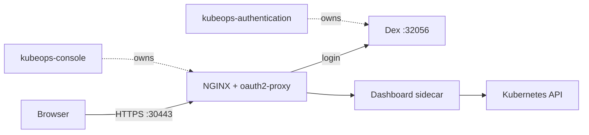

# Kube Dashboard

Themed Kubernetes console based on Dashboard v2.7.0, managed by **`kubeops-*` operators**, with Dex OIDC login by default.

[](https://github.com/Deepak-Das01/dashboard-ocp/releases/tag/v1.3.0)
[](https://github.com/kubernetes/dashboard/releases/tag/v2.7.0)
[](#prerequisites)
[](deploy/kube-dashboard/deployment.yaml)
[](deploy/kube-dashboard/theme.css)
[](#contributing)
[](#license-and-acknowledgements)

> **Independent project.** kube-dashboard is a community packaging and cosmetic customization of the official [Kubernetes Dashboard](https://github.com/kubernetes/dashboard). It is **not** an official Kubernetes, CNCF, or Apple product.

| Item | Value |
|------|--------|
| Product | Kube Dashboard |
| Release | **v1.3.0** (stable packaging) + **kubeops operators** on `main` |
| Version | **1.3.0** |
| Upstream Dashboard | `kubernetesui/dashboard:v2.7.0` |
| Metrics scraper | `kubernetesui/metrics-scraper:v1.0.8` |
| Console image (proxy) | `nginx:1.27-alpine` |
| Auth (default) | **OIDC via Dex** (`kubeadmin`) |
| Default HTTPS NodePort | **30443** |
| Default HTTP NodePort | **30080** (redirects to HTTPS) |
| Dex NodePort | **32056** |
| Namespaces | `kubeops-console`, `kubeops-authentication` |
| Repository | [github.com/Deepak-Das01/dashboard-ocp](https://github.com/Deepak-Das01/dashboard-ocp) |

---

## Quick start (recommended)

Requires: `kubectl`, `go`, `python3`, `ctr` (containerd), cluster-admin kubeconfig.

```bash
git clone https://github.com/Deepak-Das01/dashboard-ocp.git
cd dashboard-ocp
git checkout main

./scripts/install-operators.sh
```

```bash
kubectl get ops
kubectl get kubedashboard,clusteroidc
kubectl get pods -n kubeops-console
kubectl get pods -n kubeops-authentication
```

**Browser:** `https://<node-ip>:30443/` → Dex → sign in as `kubeadmin`

```bash
kubectl -n kubeops-authentication get secret kubeadmin-oidc-bootstrap \
  -o jsonpath='{.data.password}' | base64 -d; echo
```

Use a private window if old cookies interfere. CLI stays on your existing kubeconfig.

| Flag | Default | Meaning |
|------|---------|---------|
| `AUTH_MODE` | `oidc` | `oidc` \| `secret` \| `token` |
| `LOAD_IMAGES` | `true` | Load dashboard/metrics image tars |
| `LOAD_IMAGES=false` | — | Skip image download/import if already present |

```bash
LOAD_IMAGES=false ./scripts/install-operators.sh
AUTH_MODE=secret ./scripts/install-operators.sh   # NGINX basic auth instead of Dex
```

Full operator docs: [docs/OPERATOR_AND_AUTH.md](docs/OPERATOR_AND_AUTH.md).

---

## Operators (`kubeops-*`)

Name = namespace. Role (`spec.component`) is `console` or `oidc`.

| Operator | Namespace | Role | Owns |
|----------|-----------|------|------|
| **kubeops-console** | `kubeops-console` | `console` | Operator + `kube-dashboard` UI + metrics-scraper |
| **kubeops-authentication** | `kubeops-authentication` | `oidc` | Operator + Dex IdP + OIDC secrets |

```text
kubeops-console/
  kubeops-console          # operator
  kube-dashboard           # NGINX + Dashboard + oauth2-proxy
  dashboard-metrics-scraper

kubeops-authentication/
  kubeops-authentication   # operator
  dex                      # OIDC login (NodePort 32056)
```

```bash
kubectl get ops
# NAME                     COMPONENT   PHASE
# kubeops-console          console     Ready
# kubeops-authentication   oidc        Ready
```

---

## Table of contents

- [Quick start (recommended)](#quick-start-recommended)
- [Operators (kubeops-)](#operators-kubeops-)
- [Product overview](#product-overview)
- [Screenshots](#screenshots)
- [Features](#features)
- [Technology stack](#technology-stack)
- [Architecture](#architecture)
- [Prerequisites](#prerequisites)
- [Classic install (scripts/install.sh)](#classic-install-scriptsinstallsh)
- [Detailed manual installation](#detailed-manual-installation)
- [Accessing the dashboard](#accessing-the-dashboard)
- [Authentication and authorization](#authentication-and-authorization)
- [Deployment verification](#deployment-verification)
- [Theme customization](#theme-customization)
- [Configuration reference](#configuration-reference)
- [Troubleshooting](#troubleshooting)
- [Upgrading](#upgrading)
- [Rollback](#rollback)
- [Uninstallation](#uninstallation)
- [Repository structure](#repository-structure)
- [Security and known limitations](#security-and-known-limitations)
- [Roadmap](#roadmap)
- [Releases and changelog](#releases-and-changelog)
- [Contributing](#contributing)
- [License and acknowledgements](#license-and-acknowledgements)

---

## Product overview

**Kube Dashboard** delivers a refined visual theme for the official Kubernetes Dashboard **without rebuilding** the upstream Angular application.

The Dashboard binary runs as a **sidecar** in the `kube-dashboard` pod. NGINX:

1. Terminates TLS for a convenient NodePort HTTPS endpoint.
2. Proxies to the Dashboard sidecar on loopback (`127.0.0.1:9090`).
3. Injects `theme.css` and `nav-accordion.js` into HTML responses.

### Why this project exists

Operators often want a clearer, more modern cluster UI while keeping familiar Dashboard workflows. This packaging focuses on **cosmetic modernization** and a single-pod install, while preserving upstream routes, APIs, authentication, and RBAC behaviour.

### What you get

- A sapphire / charcoal / teal ambient visual identity.
- Translucent panels, reflective borders, and layered depth.
- Polished header, namespace selector, tables, forms, and overlays.
- The same workload, networking, storage, and RBAC management surfaces provided by Dashboard v2.7.0 (subject to your cluster permissions and services).

### What this is not

- Not a fork that recompiles the Dashboard frontend for day-to-day installs.
- Not a security modernization of Dashboard v2.7.0.
- Not production-certified or comprehensively browser-validated.

---

## Screenshots

Screenshots of the live **v1.3.0** Kube Dashboard interface should live under `docs/screenshots/` and be linked with relative Markdown paths.

> **Documentation note:** PNG assets are not yet committed in this repository. Capture them from a running v1.3.0 deployment (hard-refresh the browser first) and save the following filenames before linking them in this section:

| Suggested file | Subject |
|----------------|---------|
| `docs/screenshots/workloads-overview.png` | Workloads overview / status charts |
| `docs/screenshots/pods.png` | Pods resource table |
| `docs/screenshots/deployments.png` | Deployments |
| `docs/screenshots/namespaces.png` | Namespaces |
| `docs/screenshots/resource-table.png` | Generic resource table + pagination |
| `docs/screenshots/settings.png` | Settings |
| `docs/screenshots/yaml-editor.png` | Create from input / YAML editor |
| `docs/screenshots/create-form.png` | Create from form |
| `docs/screenshots/namespace-dropdown.png` | Namespace selector dropdown |
| `docs/screenshots/notifications.png` | Notification panel |
| `docs/screenshots/login.png` | Login page |

Do **not** include authentication tokens, kubeconfig material, or private cluster identifiers in published screenshots.

<!-- Example (enable after assets exist):

-->

---

## Features

### Visual enhancements

Cosmetic improvements delivered by `deploy/kube-dashboard/theme.css`:

- Premium macOS-inspired Kube Dashboard interface
- Sapphire-blue, charcoal, and teal ambient gradients
- Translucent glass surfaces with backdrop blur where supported
- Reflective borders and layered visual depth
- Frosted dropdown menus and elevated overlays
- Polished navigation sidebar with consistent active selection
- Improved namespace selector (closed control and open search surface)
- Refined search and header controls
- Consistent resource tables and glass-styled pagination footers
- Corrected notification overlay stacking and compact empty state
- Refined settings, floating labels, and form alignment
- Coordinated YAML/JSON editor appearance
- Emerald workload status indicators
- Smooth hover and focus transitions
- `prefers-reduced-motion` support
- Improved Events table text containment (in-cell wrapping; no table layout changes)

### Existing Kubernetes management capabilities

Inherited from **upstream Kubernetes Dashboard v2.7.0** (not introduced by Kube Dashboard). Availability depends on Kubernetes RBAC and cluster services:

- Workload overview and status charts
- Pods, Deployments, StatefulSets, DaemonSets, ReplicaSets, Replication Controllers
- Jobs and CronJobs
- Services, Ingresses, and Ingress Classes
- ConfigMaps and Secrets
- PersistentVolumes, PersistentVolumeClaims, and StorageClasses
- Namespaces, Nodes, and Events
- NetworkPolicies
- ServiceAccounts, Roles, RoleBindings, ClusterRoles, ClusterRoleBindings
- Custom Resource Definitions
- Resource filtering and search
- YAML / JSON create and edit flows
- Pod logs and terminal access (when permitted)
- Metrics visualization when the metrics scraper and cluster metrics stack are available

Kube Dashboard does **not** add new Kubernetes management APIs or controllers.

---

## Technology stack

| Component | Technology |
|-----------|------------|
| Base application | Kubernetes Dashboard **v2.7.0** (`kubernetesui/dashboard:v2.7.0`) |
| UI framework | Upstream Angular + Angular Material (bundled in Dashboard image) |
| Custom theme | CSS (`deploy/kube-dashboard/theme.css`) |
| Reverse proxy | NGINX **1.27-alpine** (`nginx:1.27-alpine`) |
| Deployment | Kubernetes manifests + Kustomize (`deploy/`) |
| Configuration | ConfigMaps `kube-dashboard-ui`, `kube-dashboard-nginx` |
| Metrics | Dashboard metrics scraper `kubernetesui/metrics-scraper:v1.0.8` |
| Authentication | OIDC (Dex + oauth2-proxy) by default; secret/token modes available |
| Authorization | Kubernetes RBAC |
| TLS for console | Secret `kube-dashboard-tls` (self-signed via `scripts/create-tls-secret.sh`) |

---

## Architecture

### Operator path (default)

```text
Browser
  │
  ├─ http://<node>:30080  ──301──► https://<node>:30443/
  └─ https://<node>:30443/
           │
           ▼  auth_request (unauthenticated → /oauth2/start)
     kube-dashboard (kubeops-console ns)
     ┌─────────────────────────────────────┐
     │ NGINX → oauth2-proxy → Dex (:32056) │
     │ On success: inject SA bearer        │
     │ → Dashboard sidecar :9090           │
     └─────────────────────────────────────┘
           │
           ▼
     Kubernetes API
```

| Piece | Namespace | Job |
|-------|-----------|-----|
| `kubeops-console` | `kubeops-console` | Reconciles `KubeDashboard` |
| `kube-dashboard` | `kubeops-console` | UI (NGINX + Dashboard + oauth2-proxy) |
| `kubeops-authentication` | `kubeops-authentication` | Reconciles `ClusterOIDC` |
| `dex` | `kubeops-authentication` | OIDC IdP / login form |

### Mermaid diagram



---

## Prerequisites

### Mandatory

- A working Kubernetes cluster
- `kubectl` configured for the target context
- Permission to apply the upstream Dashboard manifests and this repository’s `deploy/` package
- Network access to pull (or locally preload):
  - `kubernetesui/dashboard:v2.7.0`
  - `kubernetesui/metrics-scraper:v1.0.8`
  - `nginx:1.27-alpine`
- `openssl` (used by `scripts/create-tls-secret.sh`)
- `bash`, `git`, and a modern browser

### Optional

- NodePort reachability from your workstation (or use port-forward)
- Cluster metrics components if you want populated Dashboard charts
- A custom TLS certificate to replace the generated self-signed secret

### Lab-tested Kubernetes version

This packaging was exercised in a lab on **Kubernetes v1.34.13**. Compatibility with every distribution or version is **not** claimed.

### Pre-flight checks

```bash
kubectl config current-context
kubectl cluster-info
kubectl get nodes
```

---

## Classic install (`scripts/install.sh`)

Script/kustomize path **without** operators (namespace `kubernetes-dashboard`, token login). Prefer [Quick start](#quick-start-recommended) for the kubeops + OIDC path.

```bash
kubectl config current-context
./scripts/install.sh

kubectl -n kubernetes-dashboard get svc kube-dashboard
./scripts/get-token.sh
# Open https://<NODE_IP>:30443/
```

`install.sh` downloads image archives from GitHub Release **`images-v1.2.2`** when `artifacts/images/*.tar` are missing. See [docs/METRICS_AND_IMAGES.md](docs/METRICS_AND_IMAGES.md).

> [!WARNING]
> Dashboard runs with `--enable-insecure-login` on loopback only; metrics-server includes `--kubelet-insecure-tls` for lab convenience. Prefer proper TLS and review both for shared/production environments.

---

## Detailed manual installation

Use this when you want explicit control over each step. Namespace: **`kubernetes-dashboard`**.

### 0. Images (optional if already on the node)

```bash
./scripts/download-images.sh   # GitHub Release images-v1.2.2
./scripts/load-images.sh
```

### 1. metrics-server + Dashboard support resources (vendored)

```bash
kubectl apply -f deploy/metrics-server/components.yaml
kubectl -n kube-system rollout status deploy/metrics-server --timeout=180s

# RBAC, secrets, metrics-scraper only — no separate kubernetes-dashboard Deployment
kubectl apply -f deploy/upstream/dashboard-support-v2.7.0.yaml
kubectl -n kubernetes-dashboard rollout status deploy/dashboard-metrics-scraper --timeout=180s
```

### 2. TLS secret for kube-dashboard (namespace-scoped)

```bash
./scripts/create-tls-secret.sh
# Creates/updates Secret kubernetes-dashboard/kube-dashboard-tls
```

Optional SAN override:

```bash
EXTRA_SAN="IP:10.0.0.10,DNS:dashboard.example.com" ./scripts/create-tls-secret.sh
```

### 3. kube-dashboard + optional login ServiceAccount (Kustomize)

```bash
kubectl apply -k deploy/
kubectl -n kubernetes-dashboard rollout status deploy/kube-dashboard --timeout=120s
```

This applies:

| Resource | Scope | Purpose |
|----------|-------|---------|
| ConfigMap `kube-dashboard-ui` | Namespace | Theme CSS + nav accordion JS |
| ConfigMap `kube-dashboard-nginx` | Namespace | NGINX config |
| Deployment/Service `kube-dashboard` | Namespace | Console (NGINX + Dashboard sidecar) |
| ServiceAccount `dashboard-admin` | Namespace | Optional token login helper |
| Secret `dashboard-admin-token` | Namespace | SA token secret (compatibility) |
| ClusterRoleBinding `dashboard-admin` | Cluster | Binds SA to **`cluster-admin`** |

> [!IMPORTANT]
> The bundled `dashboard-admin` binding uses **`cluster-admin`** for lab convenience. Prefer a least-privilege Role/ClusterRole for real environments. Installing the app and using the app are separate permission concerns.

### Verify after each major step

```bash
kubectl -n kubernetes-dashboard get deploy,svc,cm,sa
kubectl get clusterrolebinding dashboard-admin
```

---

## Accessing the dashboard

### NodePort (default)

Committed defaults in `deploy/kube-dashboard/service.yaml`:

| Port name | Service port | NodePort |
|-----------|--------------|----------|
| `https` | 443 → container 8443 | **30443** |
| `http` | 80 → container 8080 | **30080** (301 redirect to HTTPS `:30443`) |

Discover values and a node address:

```bash
kubectl -n kubernetes-dashboard get svc kube-dashboard -o wide
kubectl get nodes -o wide
```

URL format:

```text
https://<NODE_IP>:30443/
```

Do not treat any single lab node IP as a public product URL.

### Port-forward

```bash
kubectl -n kubernetes-dashboard port-forward svc/kube-dashboard 8443:443
```

Then open `https://127.0.0.1:8443/`.

### TLS certificates

HTTPS uses Secret **`kube-dashboard-tls`**. The helper script generates a **self-signed** certificate. Browsers will show a trust warning until you replace the secret with a certificate your environment trusts.

Do not globally disable TLS verification as standard guidance.

### Ingress / LoadBalancer

Not provided as built-in product manifests. Operators may publish `kube-dashboard` through their own Ingress or LoadBalancer configuration.

---

## Authentication and authorization

### Operator path (default OIDC)

1. Open `https://<node-ip>:30443/` (accept self-signed cert if prompted).
2. You are redirected to **Dex** (`:32056`).
3. Sign in as **`kubeadmin`** with the password from `kubeops-authentication/kubeadmin-oidc-bootstrap`.
4. After login, NGINX injects a `dashboard-admin` SA bearer so the UI has cluster-admin API access.

CLI access continues to use your existing kubeconfig (not the browser OIDC session).

Optional: wire apiserver OIDC for kubectl-as-kubeadmin — see [docs/OPERATOR_AND_AUTH.md](docs/OPERATOR_AND_AUTH.md).

### Classic / token path

```bash
./scripts/get-token.sh
# Defaults: NS=kubernetes-dashboard SA=dashboard-admin DURATION=24h
```

Never commit, paste into issues, or publish real tokens.

### Least privilege

- Create a dedicated ServiceAccount with only the Role/ClusterRole your operators need.
- Point `SA=...` when calling `get-token.sh`, or create tokens with `kubectl create token`.
- Treat `dashboard-admin` → `cluster-admin` as a lab shortcut, not a production default.

### Common auth failures

| Symptom | Likely cause |
|---------|----------------|
| HTTP 401 | Missing/invalid/expired token |
| HTTP 403 | Token valid but RBAC denies the API request |
| Login page loops / errors | Wrong URL scheme/port; use the HTTPS NodePort endpoint |

---

## Deployment verification

```bash
# Workloads
kubectl -n kubernetes-dashboard get deploy
kubectl -n kubernetes-dashboard get pods
kubectl -n kubernetes-dashboard rollout status deploy/kube-dashboard
kubectl -n kubernetes-dashboard rollout status deploy/kubernetes-dashboard
kubectl -n kubernetes-dashboard rollout status deploy/dashboard-metrics-scraper

# Networking & config
kubectl -n kubernetes-dashboard get svc kube-dashboard kubernetes-dashboard dashboard-metrics-scraper
kubectl -n kubernetes-dashboard get cm kube-dashboard-css kube-dashboard-nginx
kubectl -n kubernetes-dashboard get endpoints kube-dashboard

# Logs
kubectl -n kubernetes-dashboard logs deploy/kube-dashboard --tail=100
kubectl -n kubernetes-dashboard logs deploy/kubernetes-dashboard --tail=100
kubectl -n kubernetes-dashboard logs deploy/dashboard-metrics-scraper --tail=100
```

Expected success signals:

- Deployments show desired replicas available
- Pods are `Running` and Ready
- Service `kube-dashboard` exposes NodePorts `30443` / `30080` (unless customized)

### Confirm Kube Dashboard CSS is served

```bash
curl -skI https://127.0.0.1:30443/theme.css
# or via port-forward:
# curl -skI https://127.0.0.1:8443/theme.css
```

Expect HTTP `200` and `Content-Type` including `text/css`. Hard-refresh the browser after CSS updates.

---

## Theme customization

Stylesheet path:

```text
deploy/kube-dashboard/theme.css
```

### Useful CSS variables (`:root`)

| Variable | Role |
|----------|------|
| `--masthead-glass` | Header / toolbar ambient gradient |
| `--glass-surface` / `--glass-surface-flat` / `--glass-surface-elevated` | Panel fills |
| `--glass-surface-recessed` | Recessed inputs |
| `--glass-blur` / `--glass-blur-strong` | Backdrop blur radii |
| `--glass-saturation` | Backdrop saturation |
| `--glass-border` / `--glass-highlight` | Borders and reflections |
| `--text-primary` / `--text-secondary` / `--text-muted` | Typography |
| `--link-color` | Resource links |
| `--status-success` / `--status-warning` / `--status-error` / `--status-info` | Status colours |
| `--glass-shadow` / `--glass-shadow-elevated` | Depth |

Safe example (edit locally, then redeploy the ConfigMap):

```css
:root {
  --glass-blur-strong: 40px;
  --link-color: #8DC4FF;
  --status-success: #43D6A0;
}
```

### Apply stylesheet updates

Using Kustomize (regenerates ConfigMaps from files):

```bash
kubectl apply -k deploy/
kubectl -n kubernetes-dashboard rollout restart deploy/kube-dashboard
kubectl -n kubernetes-dashboard rollout status deploy/kube-dashboard
```

Or update only the CSS ConfigMap:

```bash
kubectl create configmap kube-dashboard-css \
  --from-file=theme.css=deploy/kube-dashboard/theme.css \
  -n kubernetes-dashboard --dry-run=client -o yaml | kubectl apply -f -
kubectl -n kubernetes-dashboard rollout restart deploy/kube-dashboard
```

Then hard-refresh the browser (CSS is served with `Cache-Control: no-cache`, but clients may still cache aggressively).

---

## Configuration reference

| Parameter | Default | Where configured |
|-----------|---------|------------------|
| Namespace | `kubernetes-dashboard` | `deploy/kustomization.yaml`, scripts `NS` |
| Upstream Dashboard version | `v2.7.0` | `scripts/install.sh` `DASHBOARD_VERSION` |
| Upstream manifest | `deploy/upstream/dashboard-recommended-v2.7.0.yaml` | `DASHBOARD_MANIFEST` |
| Skip upstream install | `false` | `SKIP_UPSTREAM=true` |
| Install metrics-server | `true` | `INSTALL_METRICS_SERVER` |
| Load/download images | `true` | `LOAD_IMAGES` / `scripts/download-images.sh` |
| Image release tag | `images-v1.2.2` | `IMAGE_RELEASE_TAG` |
| Enable insecure login patch | `true` | `ENABLE_INSECURE_LOGIN` in `install.sh` |
| Console proxy image | `nginx:1.27-alpine` | `deploy/kube-dashboard/deployment.yaml` |
| Dashboard image | `kubernetesui/dashboard:v2.7.0` | Vendored upstream manifest |
| Metrics scraper image | `kubernetesui/metrics-scraper:v1.0.8` | Vendored upstream manifest |
| metrics-server image | `registry.k8s.io/metrics-server/metrics-server:v0.7.2` | `deploy/metrics-server/components.yaml` |
| Service type | `NodePort` | `deploy/kube-dashboard/service.yaml` |
| HTTPS NodePort | `30443` | `deploy/kube-dashboard/service.yaml` |
| HTTP NodePort | `30080` | `deploy/kube-dashboard/service.yaml` |
| TLS secret name | `kube-dashboard-tls` | `scripts/create-tls-secret.sh` / Deployment volume |
| Theme stylesheet | `deploy/kube-dashboard/theme.css` | ConfigMap `kube-dashboard-css` |
| NGINX config | `deploy/kube-dashboard/nginx.conf` | ConfigMap `kube-dashboard-nginx` |
| Proxy CPU/memory | requests `20m`/`32Mi`, limits `200m`/`128Mi` | `deploy/kube-dashboard/deployment.yaml` |
| Login helper SA | `dashboard-admin` | `deploy/rbac/dashboard-admin.yaml` |
| Product labels | `app.kubernetes.io/version: "1.3.0"`, `dashboard.ocp/release: v1.3.0` | kube-dashboard + RBAC manifests |

This repository does **not** ship a Helm chart or invented values files.

---

## Troubleshooting

| Problem | Checks |
|---------|--------|
| Pods `Pending` | `kubectl -n kubernetes-dashboard describe pod <pod>`; node resources / taints |
| `ImagePullBackOff` | Registry access; preload images; `describe pod` events |
| `CrashLoopBackOff` (kube-dashboard) | Missing `kube-dashboard-tls`; NGINX config errors — check kube-dashboard logs |
| URL not reachable | NodePort firewall/security groups; try port-forward |
| TLS warning | Expected for self-signed cert; replace secret or trust explicitly |
| HTTP 401 | Regenerate token: `./scripts/get-token.sh` |
| HTTP 403 | Inspect RBAC for the authenticated identity |
| Expired token | Create a new token (`DURATION` / `kubectl create token`) |
| Theme missing | Confirm HTML includes `/theme.css`; `curl -skI` the stylesheet |
| Old CSS after update | Rollout restart kube-dashboard Deployment; hard-refresh browser |
| NGINX proxy errors | `logs deploy/kube-dashboard`; confirm upstream Service `kubernetes-dashboard` |
| Metrics empty / charts waiting | `kubectl top nodes`; metrics-server + scraper logs; wait ~2–5 min for samples |
| Overlay/dropdown styling | Hard-refresh; confirm served CSS matches repo file |
| Missing permissions | Dashboard features require RBAC; install rights ≠ view/edit rights |

Prefer diagnose → targeted fix. Avoid destructive cluster cleanup as a first step.

---

## Upgrading

Publishing a Git tag does **not** update a live cluster automatically.

```bash
cd dashboard-ocp
git pull origin main
# Preserve local theme edits if you customized theme.css
./scripts/install.sh
# or, if upstream + metrics-server are already present:
# SKIP_UPSTREAM=true INSTALL_METRICS_SERVER=false ./scripts/install.sh
# or: kubectl apply -k deploy/ && kubectl -n kubernetes-dashboard rollout restart deploy/kube-dashboard
```

Then verify pods and hard-refresh the browser. Compare stylesheets if needed:

```bash
curl -sk https://127.0.0.1:30443/theme.css | sha256sum
sha256sum deploy/kube-dashboard/theme.css
```

---

## Rollback

Git tags available include `v1.2.1`, `v1.2.0`, `v1.1.0`, `v1.0.0`.

```bash
git fetch --tags
git checkout v1.2.1
kubectl apply -k deploy/
kubectl -n kubernetes-dashboard rollout restart deploy/kube-dashboard
kubectl -n kubernetes-dashboard rollout status deploy/kube-dashboard
```

Checking out an older Git revision alone does **not** roll back running workloads until manifests/ConfigMaps are re-applied.

Do not use `git reset --hard` on shared `main` or force-push as a rollback procedure.

---

## Uninstallation

### Operator path

```bash
kubectl delete kubedashboard --all
kubectl delete clusteroidc --all
kubectl delete operators --all
kubectl delete ns kubeops-console kubeops-authentication
kubectl delete crd kubedashboards.dashboard.ocp clusteroidcs.dashboard.ocp operators.dashboard.ocp
kubectl delete clusterrolebinding kubeops-console kubeops-authentication dashboard-admin oidc-kubeadmin --ignore-not-found
```

### Classic path

```bash
./scripts/uninstall.sh
```

Removes classic `deploy/` resources and Secret `kube-dashboard-tls`.

Optional:

```bash
REMOVE_UPSTREAM=true ./scripts/uninstall.sh
REMOVE_METRICS_SERVER=true ./scripts/uninstall.sh
REMOVE_UPSTREAM=true REMOVE_METRICS_SERVER=true ./scripts/uninstall.sh
```

> [!WARNING]
> Do not delete the `kubernetes-dashboard` namespace if it contains unrelated workloads you still need. The uninstall script does not blindly wipe arbitrary cluster objects beyond the kube-dashboard kustomization (and optional upstream / metrics-server manifests when enabled).

---

## Repository structure

```text
dashboard-ocp/
├── README.md
├── CHANGELOG.md
├── VERSION / RELEASE
├── operator/                 # kubeops-console + kubeops-authentication
│   ├── cmd/console|oidc/
│   ├── config/crd|rbac|manager|samples/
│   └── internal/…
├── deploy/                   # classic kustomize packaging (install.sh)
├── scripts/
│   ├── install-operators.sh  # recommended (kubeops + OIDC)
│   ├── pack-static-image.py
│   ├── install-phase-c-oidc.sh / configure-apiserver-oidc.sh
│   ├── install.sh / uninstall.sh
│   └── download-images.sh / load-images.sh / get-token.sh
├── artifacts/images/         # local *.tar (gitignored)
└── docs/
    ├── OPERATOR_AND_AUTH.md
    └── METRICS_AND_IMAGES.md
```

---

## Security and known limitations

- Base application is **Kubernetes Dashboard v2.7.0** (legacy upstream release).
- Kube Dashboard is a **cosmetic** customization, not a security modernization.
- Upstream maintenance, CVEs, and dependency age must be evaluated before any sensitive use.
- **Production security readiness has not been established.**
- Comprehensive cross-browser validation has not been completed.
- CSS customization can break when upstream DOM/Material classes change.
- `backdrop-filter` behaviour varies by browser; fallbacks exist when unsupported.
- Resource visibility and actions are governed entirely by Kubernetes RBAC.
- Bundled `dashboard-admin` ClusterRoleBinding uses `cluster-admin` for labs.
- HTTP→HTTPS redirect NodePort and `--enable-insecure-login` are lab-oriented conveniences.

---

## Roadmap

### Delivered

- Kube Dashboard cosmetic modernization (v1.3.0)
- Packaging via NGINX + ConfigMap CSS injection
- **kubeops-console** / **kubeops-authentication** operators
- Single-script OIDC install (`./scripts/install-operators.sh`)
- Dex login + oauth2-proxy gate for the console

### Possible future work (not implemented)

- Published operator container images on a registry
- Additional theme options
- Improved responsive layouts
- Broader accessibility testing
- Security / dependency modernization of the base stack

No delivery dates are promised.

---

## Releases and changelog

- Tags / releases: [github.com/Deepak-Das01/dashboard-ocp/tags](https://github.com/Deepak-Das01/dashboard-ocp/tags)
- Detailed notes: [`CHANGELOG.md`](CHANGELOG.md)

### v1.3.0 highlights

Stable single-pod **kube-dashboard** console (NGINX + Dashboard sidecar), themed UI, metrics-server packaging, and offline image helpers. No separate upstream dashboard or glass proxy Deployment.

Prior verified tags: `v1.2.1`, `v1.2.0`, `v1.1.0`, `v1.0.0`.

---

## Contributing

1. Fork the repository.
2. Create a feature branch from `main` or a release tag.
3. Prefer small, reviewable cosmetic or packaging changes.
4. For CSS work, edit `deploy/kube-dashboard/theme.css`, apply the ConfigMap workflow, and hard-refresh the browser.
5. Open a pull request with a clear summary and test notes.
6. File bugs with: Kubernetes version, kube-dashboard version, browser, steps to reproduce, and redacted screenshots.

Do **not** include tokens, kubeconfigs, or secrets in issues or PRs.

---

## License and acknowledgements

- This repository currently has **no committed `LICENSE` file**. Treat distribution terms carefully and consult repository owners before redistribution.
- Upstream [Kubernetes Dashboard](https://github.com/kubernetes/dashboard) is maintained by the Kubernetes / Dashboard contributors and is licensed under **Apache License 2.0**.
- Acknowledgements: Kubernetes Dashboard contributors, the Kubernetes project, Angular and Angular Material, NGINX, and Apple **macOS / visionOS** solely as **visual design inspiration**.

No affiliation, endorsement, or partnership with Apple or the Kubernetes project is implied.
