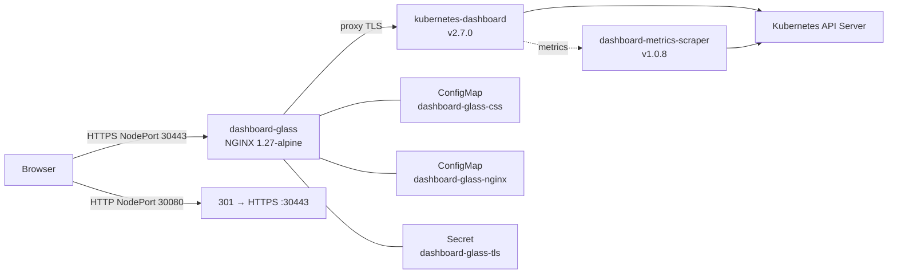

# Kubernetes Dashboard — Liquid Glass

A beautifully refined Kubernetes Dashboard featuring a premium macOS-inspired Liquid Glass interface, designed for a modern cluster management experience.

[](https://github.com/Deepak-Das01/dashboard-ocp/releases/tag/v1.2.2)
[](https://github.com/kubernetes/dashboard/releases/tag/v2.7.0)
[](#prerequisites)
[](deploy/glass/deployment.yaml)
[](deploy/glass/glass-theme.css)
[](#contributing)
[](#license-and-acknowledgements)

> **Independent project.** Liquid Glass is a community packaging and cosmetic customization of the official [Kubernetes Dashboard](https://github.com/kubernetes/dashboard). It is **not** an official Kubernetes, CNCF, or Apple product, and is not affiliated with or endorsed by those organizations.

| Item | Value |
|------|--------|
| Product | Kubernetes Dashboard — Liquid Glass |
| Release | **v1.2.2** |
| Version | **1.2.2** |
| Upstream Dashboard | `kubernetesui/dashboard:v2.7.0` |
| Metrics scraper | `kubernetesui/metrics-scraper:v1.0.8` |
| Glass proxy image | `nginx:1.27-alpine` |
| Default HTTPS NodePort | **30443** |
| Default HTTP NodePort | **30080** (redirects to HTTPS) |
| Namespace | `kubernetes-dashboard` |
| Repository | [github.com/Deepak-Das01/dashboard-ocp](https://github.com/Deepak-Das01/dashboard-ocp) |

---

## Table of contents

- [Product overview](#product-overview)
- [Screenshots](#screenshots)
- [Features](#features)
- [Technology stack](#technology-stack)
- [Architecture](#architecture)
- [Prerequisites](#prerequisites)
- [Quick start](#quick-start)
- [Detailed manual installation](#detailed-manual-installation)
- [Accessing the dashboard](#accessing-the-dashboard)
- [Authentication and authorization](#authentication-and-authorization)
- [Deployment verification](#deployment-verification)
- [Theme customization](#theme-customization)
- [Configuration reference](#configuration-reference)
- [Troubleshooting](#troubleshooting)
- [Upgrading](#upgrading)
- [Rollback](#rollback)
- [Uninstallation](#uninstallation)
- [Repository structure](#repository-structure)
- [Security and known limitations](#security-and-known-limitations)
- [Roadmap](#roadmap)
- [Releases and changelog](#releases-and-changelog)
- [Contributing](#contributing)
- [License and acknowledgements](#license-and-acknowledgements)

---

## Product overview

**Kubernetes Dashboard — Liquid Glass** delivers a premium, macOS-inspired visual theme for the official Kubernetes Dashboard **without rebuilding** the upstream Angular application.

The original Dashboard remains the application of record. This project adds a small **NGINX reverse-proxy** (`dashboard-glass`) that:

1. Terminates TLS for a convenient NodePort HTTPS endpoint.
2. Proxies traffic to the in-cluster Dashboard service.
3. Injects `glass-theme.css` into Dashboard HTML responses.

### Why this project exists

Operators often want a clearer, more modern cluster UI while keeping the familiar Kubernetes Dashboard workflows. Liquid Glass focuses on **cosmetic modernization**—gradients, frosted glass materials, refined controls, and consistent overlays—while preserving upstream routes, APIs, authentication, and RBAC behaviour.

### What you get

- A sapphire / charcoal / teal ambient visual identity.
- Translucent panels, reflective borders, and layered depth.
- Polished header, namespace selector, tables, forms, and overlays.
- The same workload, networking, storage, and RBAC management surfaces provided by Dashboard v2.7.0 (subject to your cluster permissions and services).

### What this is not

- Not a fork that recompiles the Dashboard frontend for day-to-day installs.
- Not a security modernization of Dashboard v2.7.0.
- Not production-certified or comprehensively browser-validated.

---

## Screenshots

Screenshots of the live **v1.2.2** Liquid Glass interface should live under `docs/screenshots/` and be linked with relative Markdown paths.

> **Documentation note:** PNG assets are not yet committed in this repository. Capture them from a running v1.2.2 deployment (hard-refresh the browser first) and save the following filenames before linking them in this section:

| Suggested file | Subject |
|----------------|---------|
| `docs/screenshots/workloads-overview.png` | Workloads overview / status charts |
| `docs/screenshots/pods.png` | Pods resource table |
| `docs/screenshots/deployments.png` | Deployments |
| `docs/screenshots/namespaces.png` | Namespaces |
| `docs/screenshots/resource-table.png` | Generic resource table + pagination |
| `docs/screenshots/settings.png` | Settings |
| `docs/screenshots/yaml-editor.png` | Create from input / YAML editor |
| `docs/screenshots/create-form.png` | Create from form |
| `docs/screenshots/namespace-dropdown.png` | Namespace selector dropdown |
| `docs/screenshots/notifications.png` | Notification panel |
| `docs/screenshots/login.png` | Login page |

Do **not** include authentication tokens, kubeconfig material, or private cluster identifiers in published screenshots.

<!-- Example (enable after assets exist):

-->

---

## Features

### Liquid Glass visual enhancements

Cosmetic improvements delivered by `deploy/glass/glass-theme.css`:

- Premium macOS-inspired Liquid Glass interface
- Sapphire-blue, charcoal, and teal ambient gradients
- Translucent glass surfaces with backdrop blur where supported
- Reflective borders and layered visual depth
- Frosted dropdown menus and elevated overlays
- Polished navigation sidebar with consistent active selection
- Improved namespace selector (closed control and open search surface)
- Refined search and header controls
- Consistent resource tables and glass-styled pagination footers
- Corrected notification overlay stacking and compact empty state
- Refined settings, floating labels, and form alignment
- Coordinated YAML/JSON editor appearance
- Emerald workload status indicators
- Smooth hover and focus transitions
- `prefers-reduced-motion` support
- Improved Events table text containment (in-cell wrapping; no table layout changes)

### Existing Kubernetes management capabilities

Inherited from **upstream Kubernetes Dashboard v2.7.0** (not introduced by Liquid Glass). Availability depends on Kubernetes RBAC and cluster services:

- Workload overview and status charts
- Pods, Deployments, StatefulSets, DaemonSets, ReplicaSets, Replication Controllers
- Jobs and CronJobs
- Services, Ingresses, and Ingress Classes
- ConfigMaps and Secrets
- PersistentVolumes, PersistentVolumeClaims, and StorageClasses
- Namespaces, Nodes, and Events
- NetworkPolicies
- ServiceAccounts, Roles, RoleBindings, ClusterRoles, ClusterRoleBindings
- Custom Resource Definitions
- Resource filtering and search
- YAML / JSON create and edit flows
- Pod logs and terminal access (when permitted)
- Metrics visualization when the metrics scraper and cluster metrics stack are available

Liquid Glass does **not** add new Kubernetes management APIs or controllers.

---

## Technology stack

| Component | Technology |
|-----------|------------|
| Base application | Kubernetes Dashboard **v2.7.0** (`kubernetesui/dashboard:v2.7.0`) |
| UI framework | Upstream Angular + Angular Material (bundled in Dashboard image) |
| Custom theme | CSS (`deploy/glass/glass-theme.css`) |
| Reverse proxy | NGINX **1.27-alpine** (`nginx:1.27-alpine`) |
| Deployment | Kubernetes manifests + Kustomize (`deploy/`) |
| Configuration | ConfigMaps `dashboard-glass-css`, `dashboard-glass-nginx` |
| Metrics | Dashboard metrics scraper `kubernetesui/metrics-scraper:v1.0.8` |
| Authentication | Upstream Dashboard token / kubeconfig login flows |
| Authorization | Kubernetes RBAC |
| TLS for Glass UI | Secret `dashboard-glass-tls` (self-signed via `scripts/create-tls-secret.sh`) |

---

## Architecture

### Request flow

```text
Browser
  │
  ├─ http://<node>:30080  ──301──► https://<node>:30443/
  └─ https://<node>:30443/ ──────────────┐
                                         ▼
                              dashboard-glass (NGINX TLS)
                               │  serves /glass-theme.css
                               │  injects stylesheet into HTML
                               ▼
                    kubernetes-dashboard:443
                               │
                               ▼
                         Kubernetes API
                               ▲
                    dashboard-metrics-scraper
                    (metrics for Dashboard charts)
```

The Glass proxy preserves the original Dashboard application. Standard installs **do not require** custom frontend compilation.

### Mermaid diagram



---

## Prerequisites

### Mandatory

- A working Kubernetes cluster
- `kubectl` configured for the target context
- Permission to apply the upstream Dashboard manifests and this repository’s `deploy/` package
- Network access to pull (or locally preload):
  - `kubernetesui/dashboard:v2.7.0`
  - `kubernetesui/metrics-scraper:v1.0.8`
  - `nginx:1.27-alpine`
- `openssl` (used by `scripts/create-tls-secret.sh`)
- `bash`, `git`, and a modern browser

### Optional

- NodePort reachability from your workstation (or use port-forward)
- Cluster metrics components if you want populated Dashboard charts
- A custom TLS certificate to replace the generated self-signed secret

### Lab-tested Kubernetes version

This packaging was exercised in a lab on **Kubernetes v1.34.13**. Compatibility with every distribution or version is **not** claimed.

### Pre-flight checks

```bash
kubectl config current-context
kubectl cluster-info
kubectl get nodes
```

---

## Quick start

Exact clone URL from the configured Git remote:

```bash
git clone https://github.com/Deepak-Das01/dashboard-ocp.git
cd dashboard-ocp
git fetch --tags
git checkout v1.2.2
```

Verify context, then install with the repository script (applies upstream Dashboard v2.7.0, creates TLS, applies Glass manifests):

```bash
kubectl config current-context
./scripts/install.sh
```

Wait for the script to finish rollout checks, then discover access:

```bash
kubectl -n kubernetes-dashboard get svc dashboard-glass
kubectl get nodes -o wide
```

Open:

```text
https://<NODE_IP>:30443/
```

Generate a login token (optional helper ServiceAccount shipped with this package):

```bash
./scripts/get-token.sh
```

> [!NOTE]
> Installation instructions are validated **statically** against the committed scripts and manifests, and match the lab install workflow previously used for this repository. This documentation update does **not** re-run a live install.

> [!WARNING]
> `scripts/install.sh` defaults `ENABLE_INSECURE_LOGIN=true` for lab convenience (patches upstream Dashboard args). Prefer HTTPS access and review that setting for shared environments.

---

## Detailed manual installation

Use this when you want explicit control over each step. Namespace for Glass resources: **`kubernetes-dashboard`**.

### 1. Upstream Dashboard + metrics scraper (cluster + namespace resources)

Applies the official recommended manifest for Dashboard **v2.7.0** (namespace, Deployments, Services, upstream RBAC, metrics scraper):

```bash
kubectl apply -f https://raw.githubusercontent.com/kubernetes/dashboard/v2.7.0/aio/deploy/recommended.yaml
kubectl -n kubernetes-dashboard rollout status deploy/kubernetes-dashboard --timeout=180s
kubectl -n kubernetes-dashboard rollout status deploy/dashboard-metrics-scraper --timeout=180s
```

### 2. TLS secret for the Glass proxy (namespace-scoped)

```bash
./scripts/create-tls-secret.sh
# Creates/updates Secret kubernetes-dashboard/dashboard-glass-tls
```

Optional SAN override:

```bash
EXTRA_SAN="IP:10.0.0.10,DNS:dashboard.example.com" ./scripts/create-tls-secret.sh
```

### 3. Glass UI + optional login ServiceAccount (Kustomize)

```bash
kubectl apply -k deploy/
kubectl -n kubernetes-dashboard rollout status deploy/dashboard-glass --timeout=120s
```

This applies:

| Resource | Scope | Purpose |
|----------|-------|---------|
| ConfigMap `dashboard-glass-css` | Namespace | Liquid Glass stylesheet |
| ConfigMap `dashboard-glass-nginx` | Namespace | NGINX config |
| Deployment/Service `dashboard-glass` | Namespace | Glass proxy |
| ServiceAccount `dashboard-admin` | Namespace | Optional token login helper |
| Secret `dashboard-admin-token` | Namespace | SA token secret (compatibility) |
| ClusterRoleBinding `dashboard-admin` | Cluster | Binds SA to **`cluster-admin`** |

> [!IMPORTANT]
> The bundled `dashboard-admin` binding uses **`cluster-admin`** for lab convenience. Prefer a least-privilege Role/ClusterRole for real environments. Installing the app and using the app are separate permission concerns.

### Verify after each major step

```bash
kubectl -n kubernetes-dashboard get deploy,svc,cm,sa
kubectl get clusterrolebinding dashboard-admin
```

---

## Accessing the dashboard

### NodePort (default)

Committed defaults in `deploy/glass/service.yaml`:

| Port name | Service port | NodePort |
|-----------|--------------|----------|
| `https` | 443 → container 8443 | **30443** |
| `http` | 80 → container 8080 | **30080** (301 redirect to HTTPS `:30443`) |

Discover values and a node address:

```bash
kubectl -n kubernetes-dashboard get svc dashboard-glass -o wide
kubectl get nodes -o wide
```

URL format:

```text
https://<NODE_IP>:30443/
```

Do not treat any single lab node IP as a public product URL.

### Port-forward

```bash
kubectl -n kubernetes-dashboard port-forward svc/dashboard-glass 8443:443
```

Then open `https://127.0.0.1:8443/`.

### TLS certificates

Glass HTTPS uses Secret **`dashboard-glass-tls`**. The helper script generates a **self-signed** certificate. Browsers will show a trust warning until you replace the secret with a certificate your environment trusts.

Do not globally disable TLS verification as standard guidance.

### Ingress / LoadBalancer

Not provided as built-in product manifests. Operators may publish `dashboard-glass` through their own Ingress or LoadBalancer configuration.

---

## Authentication and authorization

Liquid Glass does not replace Dashboard authentication.

1. Open the Glass HTTPS URL.
2. Sign in with a Kubernetes ServiceAccount bearer token (or other methods supported by upstream Dashboard).
3. Authorization is enforced by **Kubernetes RBAC** for that identity.

### Token helper (optional)

```bash
./scripts/get-token.sh
# Defaults: NS=kubernetes-dashboard SA=dashboard-admin DURATION=24h
```

Never commit, paste into issues, or publish real tokens.

### Least privilege

- Create a dedicated ServiceAccount with only the Role/ClusterRole your operators need.
- Point `SA=...` when calling `get-token.sh`, or create tokens with `kubectl create token`.
- Treat `dashboard-admin` → `cluster-admin` as a lab shortcut, not a production default.

### Common auth failures

| Symptom | Likely cause |
|---------|----------------|
| HTTP 401 | Missing/invalid/expired token |
| HTTP 403 | Token valid but RBAC denies the API request |
| Login page loops / errors | Wrong URL scheme/port; use HTTPS Glass endpoint |

---

## Deployment verification

```bash
# Workloads
kubectl -n kubernetes-dashboard get deploy
kubectl -n kubernetes-dashboard get pods
kubectl -n kubernetes-dashboard rollout status deploy/dashboard-glass
kubectl -n kubernetes-dashboard rollout status deploy/kubernetes-dashboard
kubectl -n kubernetes-dashboard rollout status deploy/dashboard-metrics-scraper

# Networking & config
kubectl -n kubernetes-dashboard get svc dashboard-glass kubernetes-dashboard dashboard-metrics-scraper
kubectl -n kubernetes-dashboard get cm dashboard-glass-css dashboard-glass-nginx
kubectl -n kubernetes-dashboard get endpoints dashboard-glass

# Logs
kubectl -n kubernetes-dashboard logs deploy/dashboard-glass --tail=100
kubectl -n kubernetes-dashboard logs deploy/kubernetes-dashboard --tail=100
kubectl -n kubernetes-dashboard logs deploy/dashboard-metrics-scraper --tail=100
```

Expected success signals:

- Deployments show desired replicas available
- Pods are `Running` and Ready
- Service `dashboard-glass` exposes NodePorts `30443` / `30080` (unless customized)

### Confirm Liquid Glass CSS is served

```bash
curl -skI https://127.0.0.1:30443/glass-theme.css
# or via port-forward:
# curl -skI https://127.0.0.1:8443/glass-theme.css
```

Expect HTTP `200` and `Content-Type` including `text/css`. Hard-refresh the browser after CSS updates.

---

## Theme customization

Stylesheet path:

```text
deploy/glass/glass-theme.css
```

### Useful CSS variables (`:root`)

| Variable | Role |
|----------|------|
| `--masthead-glass` | Header / toolbar ambient gradient |
| `--glass-surface` / `--glass-surface-flat` / `--glass-surface-elevated` | Panel fills |
| `--glass-surface-recessed` | Recessed inputs |
| `--glass-blur` / `--glass-blur-strong` | Backdrop blur radii |
| `--glass-saturation` | Backdrop saturation |
| `--glass-border` / `--glass-highlight` | Borders and reflections |
| `--text-primary` / `--text-secondary` / `--text-muted` | Typography |
| `--link-color` | Resource links |
| `--status-success` / `--status-warning` / `--status-error` / `--status-info` | Status colours |
| `--glass-shadow` / `--glass-shadow-elevated` | Depth |

Safe example (edit locally, then redeploy the ConfigMap):

```css
:root {
  --glass-blur-strong: 40px;
  --link-color: #8DC4FF;
  --status-success: #43D6A0;
}
```

### Apply stylesheet updates

Using Kustomize (regenerates ConfigMaps from files):

```bash
kubectl apply -k deploy/
kubectl -n kubernetes-dashboard rollout restart deploy/dashboard-glass
kubectl -n kubernetes-dashboard rollout status deploy/dashboard-glass
```

Or update only the CSS ConfigMap:

```bash
kubectl create configmap dashboard-glass-css \
  --from-file=glass-theme.css=deploy/glass/glass-theme.css \
  -n kubernetes-dashboard --dry-run=client -o yaml | kubectl apply -f -
kubectl -n kubernetes-dashboard rollout restart deploy/dashboard-glass
```

Then hard-refresh the browser (CSS is served with `Cache-Control: no-cache`, but clients may still cache aggressively).

---

## Configuration reference

| Parameter | Default | Where configured |
|-----------|---------|------------------|
| Namespace | `kubernetes-dashboard` | `deploy/kustomization.yaml`, scripts `NS` |
| Upstream Dashboard version | `v2.7.0` | `scripts/install.sh` `DASHBOARD_VERSION` |
| Upstream manifest URL | Kubernetes Dashboard `recommended.yaml` | `scripts/install.sh` `DASHBOARD_URL` |
| Skip upstream install | `false` | `SKIP_UPSTREAM=true` |
| Enable insecure login patch | `true` | `ENABLE_INSECURE_LOGIN` in `install.sh` |
| Glass Deployment image | `nginx:1.27-alpine` | `deploy/glass/deployment.yaml` |
| Dashboard image | `kubernetesui/dashboard:v2.7.0` | Upstream recommended manifest |
| Metrics scraper image | `kubernetesui/metrics-scraper:v1.0.8` | Upstream recommended manifest |
| Service type | `NodePort` | `deploy/glass/service.yaml` |
| HTTPS NodePort | `30443` | `deploy/glass/service.yaml` |
| HTTP NodePort | `30080` | `deploy/glass/service.yaml` |
| TLS secret name | `dashboard-glass-tls` | `scripts/create-tls-secret.sh` / Deployment volume |
| Theme stylesheet | `deploy/glass/glass-theme.css` | ConfigMap `dashboard-glass-css` |
| NGINX config | `deploy/glass/nginx.conf` | ConfigMap `dashboard-glass-nginx` |
| Glass CPU/memory | requests `20m`/`32Mi`, limits `200m`/`128Mi` | `deploy/glass/deployment.yaml` |
| Login helper SA | `dashboard-admin` | `deploy/rbac/dashboard-admin.yaml` |
| Product labels | `app.kubernetes.io/version: "1.2.2"`, `dashboard.ocp/release: v1.2.2` | Glass + RBAC manifests |

This repository does **not** ship a Helm chart or invented values files.

---

## Troubleshooting

| Problem | Checks |
|---------|--------|
| Pods `Pending` | `kubectl -n kubernetes-dashboard describe pod <pod>`; node resources / taints |
| `ImagePullBackOff` | Registry access; preload images; `describe pod` events |
| `CrashLoopBackOff` (Glass) | Missing `dashboard-glass-tls`; NGINX config errors — check Glass logs |
| URL not reachable | NodePort firewall/security groups; try port-forward |
| TLS warning | Expected for self-signed cert; replace secret or trust explicitly |
| HTTP 401 | Regenerate token: `./scripts/get-token.sh` |
| HTTP 403 | Inspect RBAC for the authenticated identity |
| Expired token | Create a new token (`DURATION` / `kubectl create token`) |
| Theme missing | Confirm HTML includes `/glass-theme.css`; `curl -skI` the stylesheet |
| Old CSS after update | Rollout restart Glass Deployment; hard-refresh browser |
| NGINX proxy errors | `logs deploy/dashboard-glass`; confirm upstream Service `kubernetes-dashboard` |
| Metrics empty | Metrics scraper logs; cluster metrics availability (not guaranteed) |
| Overlay/dropdown styling | Hard-refresh; confirm served CSS matches repo file |
| Missing permissions | Dashboard features require RBAC; install rights ≠ view/edit rights |

Prefer diagnose → targeted fix. Avoid destructive cluster cleanup as a first step.

---

## Upgrading

Publishing a Git tag does **not** update a live cluster automatically.

```bash
cd dashboard-ocp
git fetch --tags origin
git checkout v1.2.2
# Preserve local theme edits if you customized glass-theme.css
./scripts/install.sh
# or, if upstream is already present:
# SKIP_UPSTREAM=true ./scripts/install.sh
# or: kubectl apply -k deploy/ && kubectl -n kubernetes-dashboard rollout restart deploy/dashboard-glass
```

Then verify pods and hard-refresh the browser. Compare stylesheets if needed:

```bash
curl -sk https://127.0.0.1:30443/glass-theme.css | sha256sum
sha256sum deploy/glass/glass-theme.css
```

---

## Rollback

Git tags available include `v1.2.1`, `v1.2.0`, `v1.1.0`, `v1.0.0`.

```bash
git fetch --tags
git checkout v1.2.1
kubectl apply -k deploy/
kubectl -n kubernetes-dashboard rollout restart deploy/dashboard-glass
kubectl -n kubernetes-dashboard rollout status deploy/dashboard-glass
```

Checking out an older Git revision alone does **not** roll back running workloads until manifests/ConfigMaps are re-applied.

Do not use `git reset --hard` on shared `main` or force-push as a rollback procedure.

---

## Uninstallation

Supported script:

```bash
./scripts/uninstall.sh
```

Removes:

- Resources from `kubectl delete -k deploy/` (Glass Deployment/Service, ConfigMaps, `dashboard-admin` SA/RBAC/secret)
- Secret `dashboard-glass-tls`

Optional removal of upstream Dashboard:

```bash
REMOVE_UPSTREAM=true ./scripts/uninstall.sh
```

> [!WARNING]
> Do not delete the `kubernetes-dashboard` namespace if it contains unrelated workloads you still need. The uninstall script does not blindly wipe arbitrary cluster objects beyond the Glass kustomization (and optional upstream recommended manifest when enabled).

---

## Repository structure

```text
dashboard-ocp/
├── README.md                 # Product documentation (this file)
├── CHANGELOG.md              # Release notes
├── VERSION                   # 1.2.2
├── RELEASE                   # v1.2.2
├── deploy/
│   ├── kustomization.yaml    # Glass ConfigMaps + resources
│   ├── glass/
│   │   ├── glass-theme.css   # Liquid Glass stylesheet
│   │   ├── nginx.conf        # Reverse proxy + CSS injection
│   │   ├── deployment.yaml   # dashboard-glass
│   │   └── service.yaml      # NodePorts 30443 / 30080
│   └── rbac/
│       └── dashboard-admin.yaml
├── scripts/
│   ├── install.sh
│   ├── uninstall.sh
│   ├── create-tls-secret.sh
│   └── get-token.sh
└── docs/                     # Additional notes / future screenshots
```

This tree reflects the supported product packaging. Experimental or local rollback artifacts should not be treated as install inputs.

---

## Security and known limitations

- Base application is **Kubernetes Dashboard v2.7.0** (legacy upstream release).
- Liquid Glass is a **cosmetic** customization, not a security modernization.
- Upstream maintenance, CVEs, and dependency age must be evaluated before any sensitive use.
- **Production security readiness has not been established.**
- Comprehensive cross-browser validation has not been completed.
- CSS customization can break when upstream DOM/Material classes change.
- `backdrop-filter` behaviour varies by browser; fallbacks exist when unsupported.
- Resource visibility and actions are governed entirely by Kubernetes RBAC.
- Bundled `dashboard-admin` ClusterRoleBinding uses `cluster-admin` for labs.
- HTTP→HTTPS redirect NodePort and `--enable-insecure-login` are lab-oriented conveniences.

---

## Roadmap

### Delivered in v1.2.2

- Liquid Glass cosmetic modernization
- Component consistency (tables, pagination, overlays, forms, sidebar)
- Packaging via NGINX + ConfigMap CSS injection
- Retention of upstream Dashboard functionality

### Possible future work (not implemented)

- Additional theme options
- Improved responsive layouts
- More compact workload visualization
- Enhanced monitoring presentation
- Broader accessibility testing
- Security / dependency modernization of the base stack

No delivery dates are promised.

---

## Releases and changelog

- Tags / releases: [github.com/Deepak-Das01/dashboard-ocp/tags](https://github.com/Deepak-Das01/dashboard-ocp/tags)
- Detailed notes: [`CHANGELOG.md`](CHANGELOG.md)

### v1.2.2 highlights

Stable Liquid Glass cosmetic baseline: premium glass materials, refined header/namespace controls, consistent sidebar selection, polished tables and pagination, notification stacking/empty state, form alignment, editor/dropdown styling, emerald status colours, and Events text containment.

Prior verified tags: `v1.2.1`, `v1.2.0`, `v1.1.0`, `v1.0.0`.

---

## Contributing

1. Fork the repository.
2. Create a feature branch from `main` or a release tag.
3. Prefer small, reviewable cosmetic or packaging changes.
4. For CSS work, edit `deploy/glass/glass-theme.css`, apply the ConfigMap workflow, and hard-refresh the browser.
5. Open a pull request with a clear summary and test notes.
6. File bugs with: Kubernetes version, Dashboard/Glass versions, browser, steps to reproduce, and redacted screenshots.

Do **not** include tokens, kubeconfigs, or secrets in issues or PRs.

---

## License and acknowledgements

- This repository currently has **no committed `LICENSE` file**. Treat distribution terms carefully and consult repository owners before redistribution.
- Upstream [Kubernetes Dashboard](https://github.com/kubernetes/dashboard) is maintained by the Kubernetes / Dashboard contributors and is licensed under **Apache License 2.0**.
- Acknowledgements: Kubernetes Dashboard contributors, the Kubernetes project, Angular and Angular Material, NGINX, and Apple **macOS / visionOS** solely as **visual design inspiration**.

No affiliation, endorsement, or partnership with Apple or the Kubernetes project is implied.
